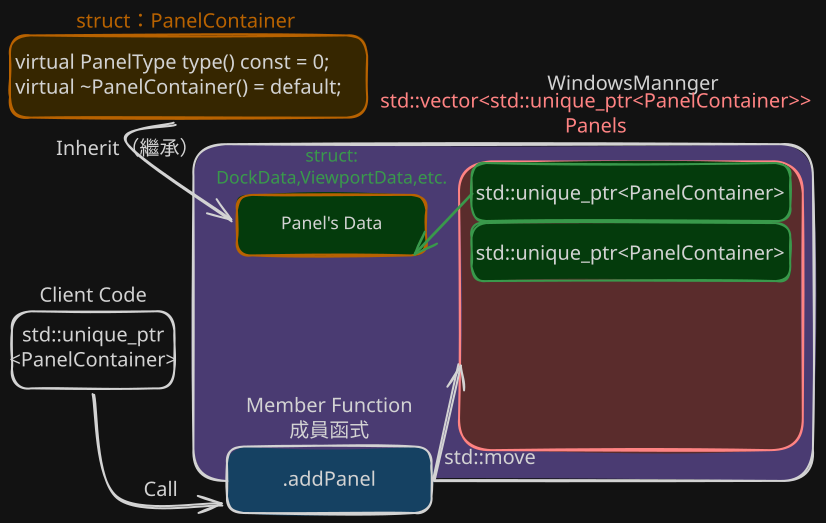

# 002. 封裝WindowsMannger

## 狀態 (Status)
已接受 (Accepted) -  ⚠️ 含有 MVP 階段的刻意技術債，待後期重構
*日期：2026-10-18*

## 背景 (Context)
- 個人獨立開發，經驗與技術都不足無法在實際需求出來之前做出完美的框架
## 決策 (Decision)

- **採用封裝+多型**的方式來儲存管理版面與視窗的 WindowManager
    - **多種視窗模式**採用多型與WindowManager成員函式互動統一管道儲存
    - **WindowMannger儲存與訪問** 為了極大化 MVP 的開發速度，WindowManager 提供 getPanelPtr(int index) 直接釋出可讀寫的
- **WindowManager存儲方法**：
WindowsMannger僅掌管真實資料生死
```
WindowsMannger<std::vector<std::unique_ptr<PanelContainer>> Panels>
```


## 後果 (Consequences)
### 好處 (Pros) 
- **開發代價極低、速度極快**： 外部系統（如 UI 事件、打字輸入、資料更新）可以直接拿到視窗實體進行邏輯操作，不需要在 WindowManager 寫任何繁瑣的轉發函式。
**加快 MVP 迭代**：新增不同功能的視窗時，只需繼承 `PanelContainer` 即可快速堆疊功能，不需頻繁改動主體的管理容器。
### 缺點與風險 (Cons) 
- **必然面臨的後期重構成本：** 這是現階段為了快速推出 MVP 的折衷方案。由於目前尚未確定實際需求，**後期「一定」需要根據真實的存取頻率與大小，回頭修改此處的儲存方式**。
- **⚠️ 耦合度極高**： 外部程式碼將會深度依賴具體的視窗型態與內容。未來若要更改視窗的儲存結構或進行多執行緒優化，將會面臨**極大的重構成本**。這被視為現階段技術債的刻意累積。
